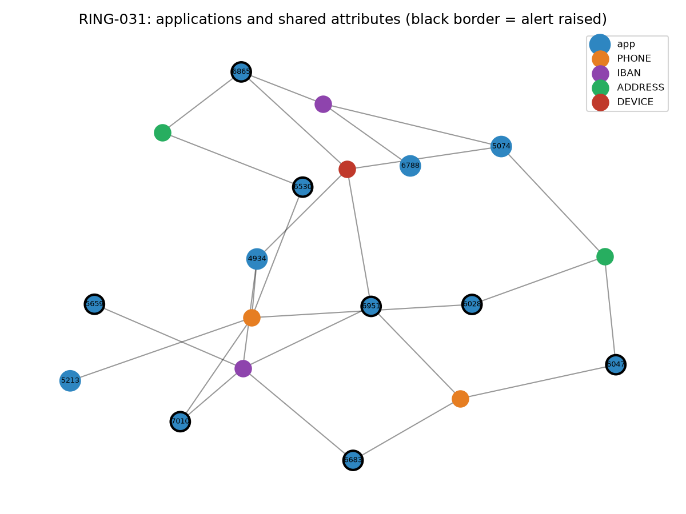

# Case Study: RING-031

## Summary

- **12 applications** through 1 branch(es) and 1 agent(s) within 40 days.
- Shared attributes: phone on 8, IBAN on 8, address on 5 and device on 4 applications.
- Total loss: **2.4M TRY**. Contract status: DEFAULTED 10, ACTIVE 1, ALLOCATED 1.
- Alerts at application time: **8/12**. First alert: 2026-01-10 12:42.

## Timeline

| app_ts           | application_id   | branch_id   | agent_id   | channel   |   financing_amount |   doc_score |   rule_score |   hybrid_score | alert   | rules_fired                                             | status    |
|:-----------------|:-----------------|:------------|:-----------|:----------|-------------------:|------------:|-------------:|---------------:|:--------|:--------------------------------------------------------|:----------|
| 2025-12-27 13:20 | APP0014934       | S008        | T0037      | WEB       |               1365 |        0.02 |            0 |          0     | False   |                                                         | DEFAULTED |
| 2025-12-30 02:19 | APP0015074       | S008        | T0037      | MOBILE    |                350 |        0.21 |            5 |          0.026 | False   | R15_NIGHT_ONLINE                                        | DEFAULTED |
| 2026-01-02 01:17 | APP0015213       | S008        | T0037      | BRANCH    |                266 |        0.01 |            0 |          0.001 | False   |                                                         | DEFAULTED |
| 2026-01-10 12:42 | APP0015659       | S008        | T0037      | BRANCH    |               1699 |        1    |           45 |          0.228 | True    | R01_DOC_FORGERY_HIGH                                    | DEFAULTED |
| 2026-01-18 05:11 | APP0016028       | S008        | T0037      | BRANCH    |                694 |        0.82 |           80 |          0.401 | True    | R01_DOC_FORGERY_HIGH,R07_SHARED_PHONE                   | DEFAULTED |
| 2026-01-18 14:54 | APP0016047       | S008        | T0037      | BRANCH    |                398 |        0.97 |           45 |          0.228 | True    | R01_DOC_FORGERY_HIGH                                    | DEFAULTED |
| 2026-01-28 07:47 | APP0016530       | S008        | T0037      | BRANCH    |               1182 |        0.08 |           35 |          0.176 | True    | R07_SHARED_PHONE                                        | DEFAULTED |
| 2026-01-31 02:09 | APP0016683       | S008        | T0037      | BRANCH    |                777 |        0.06 |           35 |          0.175 | True    | R08_SHARED_IBAN                                         | DEFAULTED |
| 2026-02-02 01:21 | APP0016788       | S008        | T0037      | BRANCH    |                608 |        0.01 |            0 |          0     | False   |                                                         | ACTIVE    |
| 2026-02-03 13:21 | APP0016865       | S008        | T0037      | MOBILE    |                274 |        0.2  |           35 |          0.176 | True    | R08_SHARED_IBAN                                         | DEFAULTED |
| 2026-02-04 21:52 | APP0016951       | S008        | T0037      | MOBILE    |                723 |        0.7  |           90 |          0.45  | True    | R02_DOC_FORGERY_MEDIUM,R07_SHARED_PHONE,R08_SHARED_IBAN | ALLOCATED |
| 2026-02-06 08:14 | APP0017010       | S008        | T0037      | BRANCH    |                860 |        0.01 |           70 |          0.351 | True    | R07_SHARED_PHONE,R08_SHARED_IBAN                        | DEFAULTED |

## Root cause

1. **The first applications looked clean.** The shared phone and IBAN rules only look at earlier applications. 3 of the first 3 applications raised no alert because their phone and IBAN had not yet been seen with another identity.
2. **Signals below the thresholds.** No rule fired on 3 of the 4 missed applications. Their average document score was 0.06, and declared income was above the occupation median but below the 3x threshold.
3. **One branch, few agents.** Most applications came through a single branch and a small number of agents. The agent rule only looks at cancellation history, so it did not see this pattern.

## Missed applications

| application_id   | app_ts                     |   rule_score |   hybrid_score | rules_fired      |
|:-----------------|:---------------------------|-------------:|---------------:|:-----------------|
| APP0014934       | 2025-12-27 13:20:28.613159 |            0 |          0     |                  |
| APP0015074       | 2025-12-30 02:19:41.568413 |            5 |          0.026 | R15_NIGHT_ONLINE |
| APP0015213       | 2026-01-02 01:17:46.686803 |            0 |          0.001 |                  |
| APP0016788       | 2026-02-02 01:21:11.960813 |            0 |          0     |                  |

## Actions

| Action | Owner |
|---|---|
| Suspend the ring's active contracts before allocation and request identity verification | Operations, Underwriting |
| Investigate the holders of the shared phones and IBANs and the agent; prepare a criminal complaint if confirmed | Internal Control, Legal |
| Re-screen earlier applications when a new link appears | Fraud Management, IT |
| Add a cluster rule: same branch, 30 days, 3+ shared attributes | Fraud Management |
