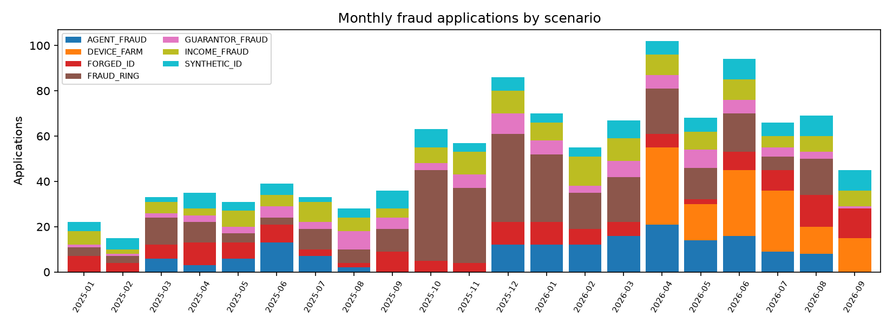
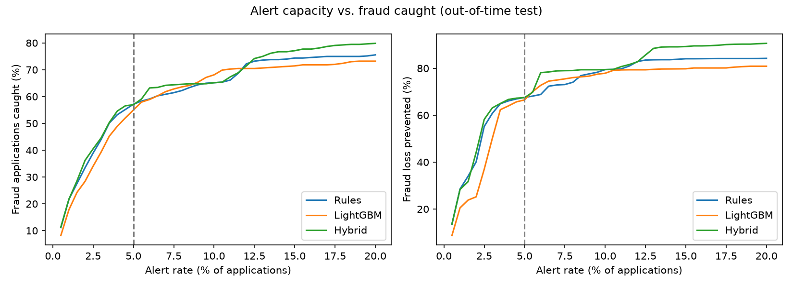
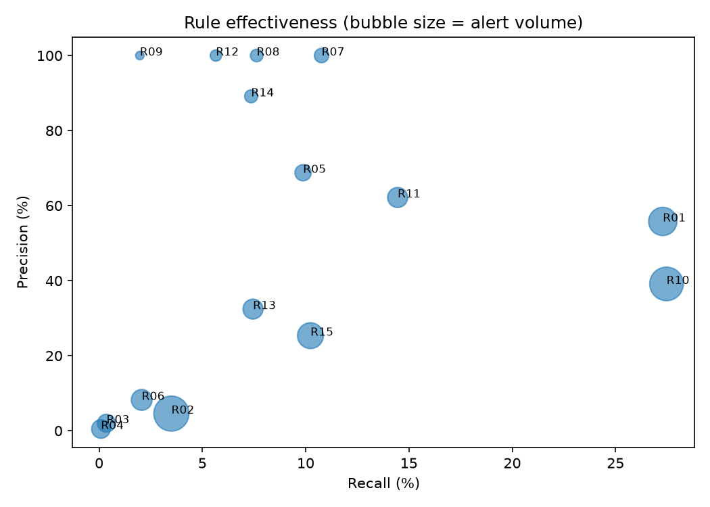
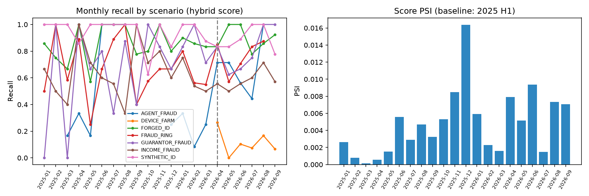

# Fraud Management Report

*Period: 2025-01-01 to 2026-09-30 · Data: synthetic applications and SIDTD ID images*

## 1. Executive summary

- **30,114 applications**, of which **1,114 (3.70%) were confirmed fraud**, with a total fraud loss of **396.9M TRY**.
- The largest loss comes from **INCOME_FRAUD** (233.3M TRY), followed by **FORGED_ID** (65.1M TRY).
- With analysts reviewing **5%** of applications, the hybrid score (rules + model) catches **56.9%** of fraud applications and **67.5%** of fraud loss in the out-of-time test (rules alone: 57.1% / 67.6%). Alert precision is **49.1%**.
- From **2026-04-01** a new pattern appears: bursts of applications under different identities from one mobile device (*device farm*). The production rules catch **12.8%** of them; the candidate rules raise this to **82.0%**.
- The document forgery model catches **92.2%** of forged documents at the threshold that sends 5% of genuine documents to review (ROC-AUC 0.983).

## 2. Fraud and loss by scenario

| Scenario        |   Applications |   Loss (M TRY) |
|:----------------|---------------:|---------------:|
| INCOME_FRAUD    |            150 |         233.34 |
| FORGED_ID       |            150 |          65.12 |
| FRAUD_RING      |            311 |          59.81 |
| SYNTHETIC_ID    |            120 |          22.03 |
| DEVICE_FARM     |            133 |           5.63 |
| GUARANTOR_FRAUD |             93 |           5.59 |
| AGENT_FRAUD     |            157 |           5.41 |

Recall by scenario in the test period (same capacity):

| scenario        |   frauds |   hybrid_recall |   rules_recall |
|:----------------|---------:|----------------:|---------------:|
| AGENT_FRAUD     |       84 |           0.595 |          0.214 |
| DEVICE_FARM     |      133 |           0.128 |          0.12  |
| FORGED_ID       |       58 |           0.879 |          0.879 |
| FRAUD_RING      |       93 |           0.72  |          0.72  |
| GUARANTOR_FRAUD |       35 |           0.743 |          0.743 |
| INCOME_FRAUD    |       55 |           0.564 |          0.564 |
| SYNTHETIC_ID    |       53 |           0.887 |          0.887 |

## 3. Score and threshold performance (out-of-time test)

| method   |   roc_auc |   pr_auc |   alert_rate |   precision |   recall |   loss_recall |
|:---------|----------:|---------:|-------------:|------------:|---------:|--------------:|
| Rules    |     0.838 |    0.493 |         0.05 |       0.492 |    0.571 |         0.676 |
| LightGBM |     0.81  |    0.417 |         0.05 |       0.474 |    0.55  |         0.665 |
| Hybrid   |     0.858 |    0.541 |         0.05 |       0.491 |    0.569 |         0.675 |

The threshold is set by analyst capacity. At this alert volume the hybrid score's recall differs from the rules by -0.2 points; over all thresholds it ranks fraud better (PR-AUC 0.541 against 0.493). The model combines signals that stay below every single rule threshold (agent history, income and down-payment ratios), while the rules keep alerts explainable.

## 4. Rule effectiveness

| rule_id                      |   alerts |   tp |   precision |   recall |   loss_caught_share |   unique_tp |   fp_per_tp |
|:-----------------------------|---------:|-----:|------------:|---------:|--------------------:|------------:|------------:|
| R10_INCOME_OUTLIER           |      782 |  306 |       0.391 |    0.275 |               0.698 |          82 |       1.556 |
| R01_DOC_FORGERY_HIGH         |      545 |  304 |       0.558 |    0.273 |               0.185 |         106 |       0.793 |
| R11_UNEXPLAINED_DOWN_PAYMENT |      259 |  161 |       0.622 |    0.145 |               0.592 |           6 |       0.609 |
| R07_SHARED_PHONE             |      120 |  120 |       1     |    0.108 |               0.062 |          33 |       0     |
| R15_NIGHT_ONLINE             |      450 |  114 |       0.253 |    0.102 |               0.04  |          45 |       2.947 |
| R05_TCKN_INVALID             |      160 |  110 |       0.688 |    0.099 |               0.072 |          10 |       0.455 |
| R08_SHARED_IBAN              |       85 |   85 |       1     |    0.076 |               0.03  |          17 |       0     |
| R13_AGENT_EARLY_CANCEL       |      256 |   83 |       0.324 |    0.075 |               0.017 |          58 |       2.084 |
| R14_YOUNG_HIGH_INCOME        |       92 |   82 |       0.891 |    0.074 |               0.048 |           4 |       0.122 |
| R12_GUARANTOR_REUSE          |       63 |   63 |       1     |    0.057 |               0.008 |          43 |       0     |
| R02_DOC_FORGERY_MEDIUM       |      854 |   39 |       0.046 |    0.035 |               0.029 |          11 |      20.897 |
| R06_TCKN_VELOCITY            |      280 |   23 |       0.082 |    0.021 |               0.028 |           1 |      11.174 |
| R09_SHARED_ADDRESS           |       22 |   22 |       1     |    0.02  |               0.003 |           2 |       0     |
| R03_MRZ_INCONSISTENT         |      200 |    4 |       0.02  |    0.004 |               0.001 |           1 |      49     |
| R04_DOC_DATE_LOGIC           |      219 |    1 |       0.005 |    0.001 |               0.002 |           0 |     218     |

- **Rules to review:** R11_UNEXPLAINED_DOWN_PAYMENT, R14_YOUNG_HIGH_INCOME, R09_SHARED_ADDRESS, R03_MRZ_INCONSISTENT, R06_TCKN_VELOCITY, R04_DOC_DATE_LOGIC. They add almost no fraud on top of the other rules (`rule_greedy_order.csv`) and should be re-tuned, merged or retired.
- Rules with a high `fp_per_tp` should contribute to the score rather than trigger a decline on their own.

## 5. Document and identity checks

| metric                     |   value |
|:---------------------------|--------:|
| doc_roc_auc                |   0.983 |
| doc_pr_auc                 |   0.974 |
| doc_recall_at_1pct_fpr     |   0.841 |
| doc_recall_at_5pct_fpr     |   0.912 |
| doc_recall_at_10pct_fpr    |   0.953 |
| field_roc_auc              |   0.974 |
| field_pr_auc               |   0.874 |
| localisation_acc_top_field |   0.912 |
| operating_threshold        |   0.328 |
| test_fpr_at_threshold      |   0.059 |
| test_recall_at_threshold   |   0.922 |

Flag rates of the OCR consistency checks on genuine and forged documents:

| check               |   evaluated |   flag_rate_genuine |   flag_rate_forged |   precision_in_sample |
|:--------------------|------------:|--------------------:|-------------------:|----------------------:|
| mrz_checkdigit_fail |          46 |               0.167 |                  0 |                     0 |
| mrz_viz_mismatch    |          40 |               0.05  |                  0 |                     0 |
| date_logic_fail     |         392 |               0.023 |                  0 |                     0 |

**Root cause:** the model misses edits most often in surname (75%), type (75%), number (83%) (`doc_model_by_tampered_field.csv`). Recall is 69.7% on Crop_and_Replace and 95.0% on Inpaint_and_Rewrite forgeries. A pasted field comes from another genuine document, so its texture carries little trace; this type needs a cross-check of the field content against the MRZ or a reference database. The OCR checks flag genuine documents more often than forged ones, so they belong on the analyst screen, not in the rule set.

## 6. Early-warning indicators (latest month)

| kri                                                       |   value | status   |
|:----------------------------------------------------------|--------:|:---------|
| Documents with forgery score >= 0.5 (%)                   |   5.022 | GREEN    |
| Online applications from a device seen with 2+ identities |  14     | AMBER    |
| Applications with a shared phone or IBAN                  |   6     | GREEN    |
| Agents with early-cancel rate >= 20% and z > 3            |   3     | RED      |
| Score PSI vs. baseline                                    |   0.007 | GREEN    |

## 7. Organised fraud and agent risk

- 133 phone, IBAN, device or guarantor values are shared by 3 or more identities. The largest cluster holds 15 identities (`sql_04_shared_attribute_clusters.csv`).
- Agents with the most unusual early-cancellation rates:

| agent_id   | branch_id   |   applications |   early_cancel_pct |   fpd_pct |   month_end_pct |   early_cancel_z |   vs_branch_peers |   confirmed_fraud |
|:-----------|:------------|---------------:|-------------------:|----------:|----------------:|-----------------:|------------------:|------------------:|
| T0116      | S014        |             75 |               50.7 |       0   |            46.7 |             9.63 |             0.438 |                37 |
| T0010      | S015        |            100 |               41   |       7   |            40   |             7.63 |             0.35  |                50 |
| T0062      | S021        |            175 |               29.1 |       1.7 |            37.7 |             5.18 |             0.207 |                53 |
| T0038      | S021        |            170 |               17.1 |       2.4 |            32.4 |             2.69 |             0.086 |                37 |
| T0092      | S009        |            154 |                9.7 |       0   |            18.2 |             1.17 |             0.054 |                 3 |

## 8. Recommended actions

| # | Action | Owner | Expected effect |
|---|---|---|---|
| 1 | Promote candidate rule `R16_DEVICE_FARM` | IT Security, Operations | Device-farm recall 12.8% → 82.0% |
| 2 | Re-screen earlier applications when a phone or IBAN becomes shared | Internal Control | Catches the first members of a ring (see case study) |
| 3 | Defer commission for agents with an early-cancellation z-score above 3 until the cancellation window closes | Sales, HR | Stops commission loss from agent fraud |
| 4 | Verify income documents at the source before allocation when the down payment is high relative to income | Underwriting | Cuts loss in the costliest scenario (income fraud) |
| 5 | Re-tune or retire weak rules (R11_UNEXPLAINED_DOWN_PAYMENT, R14_YOUNG_HIGH_INCOME, R09_SHARED_ADDRESS) | Fraud Management | Fewer alerts, higher precision |
| 6 | Require video or in-person identity verification when the document score is high | Operations, Legal | Cuts loss from forged documents |

*All figures come from synthetic data; the method and queries apply to real data unchanged.*
